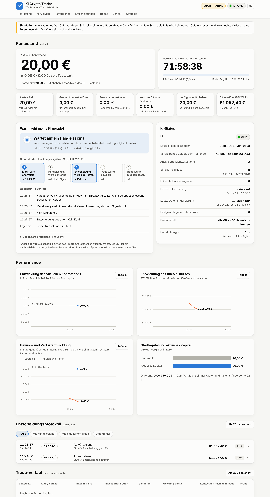

# KI Crypto Trader – 72-Stunden-Test mit Live-Dashboard

Ein automatisches Bitcoin-Handelssystem (BTC/EUR), das 72 Stunden lang selbstständig eine
Handelsstrategie testet – **ausschließlich als Simulation (Paper-Trading)**.

- Virtuelles Startkapital: **20 €**. Es wird kein echtes Geld eingesetzt.
- Es werden **keine echten Kauf- oder Verkaufsaufträge** ausgeführt. Das Programm hat keinen
  Börsenzugang und kennt keine API-Schlüssel; es liest nur öffentliche Kursdaten.
- Kein Hebel, kein Margin, keine Kredite – technisch ausgeschlossen.
- Die Kurse sind echt (Kraken, ersatzweise Coinbase und Bitstamp). Fehlen Kursdaten oder sind
  sie unplausibel, wird nicht gehandelt. Kurse werden nie geschätzt oder erfunden.

Die „KI“ ist ein nachvollziehbarer, regelbasierter Algorithmus – kein Sprachmodell und kein
neuronales Netz. Jede Entscheidung wird mit Begründung protokolliert.

> Keine Anlageberatung. Ein 72-Stunden-Test mit wenigen Trades sagt nichts Verlässliches über
> zukünftige Ergebnisse aus.

---

## Schritt für Schritt: So startest du den Test

### 1. Python prüfen

Du brauchst nur **Python 3.8 oder neuer**. Es müssen keine weiteren Pakete installiert werden.

```
python --version
```

Falls Python fehlt: von <https://www.python.org/downloads/> installieren (unter Windows beim
Installieren „Add Python to PATH“ ankreuzen). Unter macOS/Linux heißt der Befehl oft `python3`.

### 2. Projektordner öffnen

Lade das Repository herunter (grüner Knopf „Code“ → „Download ZIP“ oder `git clone`) und öffne
ein Terminal im Ordner `ki-crypto-trader`:

```
cd ki-crypto-trader
```

### 3. Test starten

```
python start.py
```

Unter Windows geht auch ein Doppelklick auf `start.bat`, unter macOS/Linux `./start.sh`.

Der 72-Stunden-Test beginnt sofort. Das Dashboard öffnet sich automatisch im Browser unter
<http://localhost:8000>. Im Terminal stehen Teststart und Testende.

### 4. 72 Stunden laufen lassen

- Das Terminalfenster offen lassen.
- **Der Rechner darf nicht in den Ruhezustand gehen** (Energiesparen für die Testdauer
  ausschalten, Laptop am Strom lassen). Im Ruhezustand kann das Programm keine Kurse prüfen.
- Die Internetverbindung muss bestehen bleiben.
- Das Browserfenster darfst du jederzeit schließen und wieder öffnen – der Test läuft im
  Terminal weiter.

### 5. Wenn etwas unterbrochen wird

Einfach erneut `python start.py` ausführen. Das Programm stellt den gespeicherten Zustand
wieder her (Kontostand, offene Position, Protokoll, Zähler) und läuft weiter. Die Testuhr läuft
dabei durch: Das Testende bleibt exakt 72 Stunden nach dem ersten Start. Ausfallzeiten werden
ehrlich im Dashboard und im Bericht vermerkt.

### 6. Nach 72 Stunden

Der simulierte Handel endet automatisch, eine noch offene Position wird zum Schlusskurs
glattgestellt und der **Abschlussbericht** wird erstellt:

- im Dashboard (Bereich „Bericht“) mit Download als PDF und CSV,
- zusätzlich als Dateien im Ordner `data/berichte/` (PDF, CSV, JSON sowie alle Trades,
  alle Entscheidungen und der Kontostandsverlauf als CSV).

Beenden kannst du das Programm mit `Strg+C` im Terminal.

### Neuen Test beginnen

```
python start.py --neu
```

Der alte Test wird nicht gelöscht, sondern nach `data/archiv/` verschoben.

---

## Nützliche Optionen

| Befehl | Wirkung |
|---|---|
| `python start.py --port 8080` | anderes Port für das Dashboard |
| `python start.py --host 0.0.0.0` | Dashboard auch vom Smartphone im selben WLAN erreichbar (`http://IP-des-Rechners:8000`) |
| `python start.py --intervall 120` | Markt alle 120 statt 60 Sekunden prüfen (erlaubt: 60–300) |
| `python start.py --kerze 15` | 15-Minuten-Kerzen statt Stundenkerzen (mehr Trades, mehr Gebühren) |
| `python start.py --dauer-stunden 0.1 --daten probe` | 6-Minuten-Probelauf in einem eigenen Ordner, um alles einmal bis zum Abschlussbericht zu sehen |
| `python start.py --kein-browser` | Browser nicht automatisch öffnen |
| `python backtest.py` | Rückblick: dieselbe Engine im Zeitraffer über die echten Kurse der letzten 72 Stunden |

Einstellungen gelten für einen neuen Test. Ein laufender Test behält seine Einstellungen.

---

## Das Dashboard



| Bereich | Inhalt |
|---|---|
| **Kontostand** | Startkapital, aktueller Kontostand, Gewinn/Verlust in € und %, Wert des virtuellen BTC-Bestands, verfügbares Guthaben, Countdown |
| **Was macht meine KI gerade?** | Tatsächlicher aktueller Zustand, die fünf Stufen des letzten Analysezyklus und die ausgeführten Schritte mit Uhrzeit |
| **KI-Status** | aktiv/pausiert, Laufzeit, Restzeit, Zahl der Analysen und Trades, letzte Entscheidung, letzte Datenaktualisierung, offene Position |
| **Performance** | Kontostand, Bitcoin-Kurs mit Käufen/Verkäufen, Gewinn/Verlust im Vergleich zu „Kaufen und Halten“, Startkapital gegen aktuelles Kapital |
| **Entscheidungsprotokoll** | Jede Entscheidung mit Zeit, Kurs, Marktsituation, Indikatorwerten, Begründung und Ergebnis; filterbar |
| **Trade-Verlauf** | Zeitpunkt, Kauf/Verkauf, Kurs, Betrag, Gebühren, Gewinn/Verlust, Kontostand danach |
| **Bericht** | Zwischenstand während des Tests, Abschlussbericht danach; Export als PDF und CSV |

Das Dashboard unterscheidet streng fünf Stufen und zeigt nur an, was wirklich passiert ist:

1. Markt wird analysiert
2. Handelssignal wurde erkannt
3. Entscheidung wurde getroffen
4. Trade wurde simuliert
5. Trade wurde abgeschlossen (erst nach dem Verkauf)

Das Dashboard kann nur lesen. Über die Weboberfläche lässt sich nichts am Test verändern.

---

## Die Strategie

Alle 60 Sekunden werden echte Kurse geladen. Aus abgeschlossenen Stundenkerzen werden fünf
Signale berechnet; jedes zählt −1, 0 oder +1:

| Signal | Positiv, wenn … |
|---|---|
| Trend (EMA 20 / EMA 50) | EMA 20 über EMA 50 und Kurs über EMA 20 |
| MACD (12, 26, 9) | Histogramm positiv und wachsend |
| RSI (14) | zwischen 55 und 70 (ab 70 gilt als überkauft → negativ) |
| Handelsvolumen | überdurchschnittlich bei steigender Kerze |
| Kurzfristige Kursbewegung | Kurs zuletzt spürbar gestiegen |

- **Kauf** nur bei Gesamtbewertung ab +3, bestätigtem Aufwärtstrend und RSI unter 70 – nie
  wegen eines einzelnen Indikators – und nur, wenn die Risikoprüfung bestanden ist.
- **Verkauf** bei Stop-Loss (−1,5 %), Gewinnziel (+3 %), nachgezogenem Stopp (ab +1,5 %
  Gewinn, Abstand 0,8 %) oder wenn die Gesamtbewertung auf −2 fällt und der Trend dreht.

### Risikoregeln

- Einsatz höchstens 90 % des freien Guthabens und nie mehr als 20 €; Mindestorder 5 €.
- Gebühr von 0,40 % je Order (Annahme in der Größenordnung üblicher Börsengebühren).
- Gekauft wird zum Briefkurs, verkauft zum Geldkurs – zu Kursen, die es wirklich gab.
- Höchstens 6 Käufe in 24 Stunden, Wartezeit nach jedem Verkauf.
- Handelsstopp, wenn der Kontostand 15 % unter das Startkapital fällt.
- Bei fehlenden, veralteten oder unplausiblen Kursdaten: Pause, kein Trade.

Alle Werte stehen in `kitrader/config.py`.

### Ehrliche Einordnung der Strategie

Vor der Fertigstellung wurde die Strategie über echte 1-Minuten-Kurse von 39 Tagen geprüft
(25.09.–10.11.2026, 13 aufeinanderfolgende 72-Stunden-Fenster). In dieser Zeit fiel der
Bitcoin-Kurs überwiegend.

| | Ø Ergebnis je 72 h | Fenster im Plus | Trades |
|---|---|---|---|
| Diese Strategie (Stundenkerzen) | −0,9 % | 2 von 13 | 13, davon 3 mit Gewinn |
| Einmal kaufen und halten | −1,9 % | – | – |

Die Strategie hat in dieser Phase also weniger verloren als reines Halten, aber **kein Geld
verdient**. Eine frühere Variante, die häufiger handelte, verlor fast ausschließlich durch
Gebühren (Ø −7,7 %) – deshalb handelt die jetzige Version bewusst selten. In 72 Stunden ist
im Schnitt etwa ein Trade zu erwarten; es kann auch gar keiner zustande kommen.

Die Regeln wurden anhand genau dieser Daten ausgewählt; für andere Zeiträume kann das
Ergebnis schlechter ausfallen. Ob die Strategie in deinem Testzeitraum Gewinn macht, ist offen.

---

## Technik

- Reines Python (Standardbibliothek), keine Installation von Paketen, keine Cloud-Dienste.
- Speicherung in `data/trader.db` (SQLite). Jeder Analysezyklus wird vollständig oder gar
  nicht gespeichert.
- Datenquellen: öffentliche Markt-APIs von Kraken, Coinbase und Bitstamp (nur lesend).

```
start.py            Programmstart (Engine + Dashboard)
backtest.py         Rückblick mit echten historischen Kursen
kitrader/
  config.py         alle Einstellungen
  marketdata.py     Kursdaten laden und streng prüfen
  indicators.py     RSI, MACD, EMA
  strategy.py       fünf Signale, Entscheidung, Begründung
  broker.py         virtuelles Konto (Gebühren, kein Hebel)
  engine.py         72-Stunden-Ablauf, Neustart-Wiederherstellung
  storage.py        SQLite-Speicherung
  report.py         Bericht, CSV- und PDF-Export
  pdfwriter.py      PDF-Erzeugung ohne Fremdbibliothek
  webserver.py      Dashboard-Server (nur lesend)
web/                Dashboard (HTML, CSS, JavaScript)
tests/              automatische Tests
```

### Tests ausführen

```
python -m unittest discover -s tests -t .
```

Die Tests prüfen unter anderem: Indikatoren gegen Referenzwerte, Gebührenrechnung, „nie mehr
als das Guthaben“, kein Handel bei Datenfehlern, Wiederherstellung nach Neustart, Testende
zum richtigen Zeitpunkt, Kennzahlen des Berichts sowie CSV- und PDF-Export.
